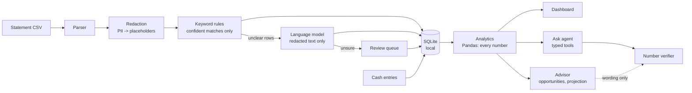

# Myfinance

**Understand. Manage. Grow.**

Myfinance is an AI personal finance advisor that you can trust with your numbers. Upload a bank-statement CSV and
it sorts each transaction into a category. It shows where your money went this month and how that compares with
last month, answers questions in plain English, and builds a ranked savings plan toward a goal you set. **Every
figure is computed by ordinary code, never by the AI model.** Each answer has a "How I got this" panel with the
exact calculation behind it. Personal details are masked before any text reaches a model, and the whole app can
run offline on your own computer.

## Features

- **Dashboard**: shows spent, income, net saved and savings rate, each with the change from the previous month.
  Also: spending by category, month-vs-month bars, a 12-month trend with unusual charges marked, plain-English
  insights, top merchants, and a filterable transactions table. You can correct any category, and the fix can
  become a rule for that merchant.
- **Ask, with verified numbers**: a chat assistant that answers only by calling typed analytics tools. A number
  verifier checks that every figure in a reply came from a tool result. If one didn't, the answer is replaced by a
  summary built directly from the results. Off-topic questions are refused before any model is called.
- **Goal-based plan**: set a target amount by a date, or a monthly savings target. Myfinance ranks ways to save
  (unused subscriptions, category trims, one-off charges) and shows a before/after projection. The projection
  updates as you tick actions on or off.
- **Cash wallet**: ATM withdrawals fill a cash wallet. You log what the cash was spent on, by form or with a quick
  line such as `chai 150`, so cash spending is counted too. The rest shows as "unaccounted".
- **Privacy**: personal details are redacted before any model call, and an offline mode keeps everything on your
  machine (see [Privacy](#privacy)).

## Architecture



The model never calculates. It picks categories for rows the rules can't decide, chooses which analytics tool to
call, and words the answer. Every number comes from `src/analytics/`, which the dashboard, the agent and the
advisor all share.

## Quick start (Windows PowerShell)

Requires Python 3.11 or newer.

```powershell
git clone https://github.com/aqsae375-ui/financial-agent.git myfinance
cd myfinance
python -m venv .venv
.\.venv\Scripts\Activate.ps1
pip install -r requirements.txt
streamlit run app.py
```

Open http://localhost:8501 and click **Load sample data** in the sidebar. The default model is an offline demo
provider, so no network or API key is needed.

To use a real model that runs locally, install [Ollama](https://ollama.com), then (or set the same values in a
`.env` file copied from `.env.example`):

```powershell
ollama pull qwen2.5:7b
$env:LLM_PROVIDER='ollama'; $env:OLLAMA_MODEL='qwen2.5:7b'; $env:OLLAMA_TIMEOUT='600'
streamlit run app.py
```

Optional: `python scripts/prepare_demo.py` rebuilds the sample database and prints a pass/fail demo checklist.

## Tests

```powershell
.\.venv\Scripts\Activate.ps1
pytest -q
```

All tests run offline with a deterministic fake provider: no network and no API key. To re-run the evaluation,
use `python scripts/run_evaluation.py --provider fake --sections all`, then `python scripts/write_eval_summary.py`.

## Privacy

- **Redaction first.** Names, e-mails, phone, card and account numbers, IBANs, bank reference codes and branch
  addresses are replaced with placeholders such as `[NAME]` when a statement is loaded. Only the redacted text is
  sent to a model. The original stays in the local database.
- **Local mode.** With the offline provider or [Ollama](https://ollama.com), nothing leaves your computer.
- **No cloud copy.** Data lives in a local SQLite file on your machine.
- **Suspicious text is held back.** A transaction description that looks like an instruction to the AI is not sent
  to a model. It is flagged and goes to the review queue instead.

## Evaluation

These are the headline results on synthetic data, using a local model (Ollama `qwen2.5:7b` on a laptop CPU). The
full method, the per-question results and every known failure are in
[results/evaluation_summary.md](results/evaluation_summary.md).

| Measure | Result |
|---|---|
| Categorization, hard set of 60 messy descriptions: rules + model | 57/60 (95.0%) |
| Categorization, same set: rules only / model only | 34/60 / 47/60 |
| Wrong decisions made by rules | 0 |
| Q&A, 24 fixed questions: unverified numbers shown to the user | 0 |
| Q&A: correct answers (graded against the computed figures) | 18/24 (75.0%) |
| Prompt-injection rows blocked | 8/8 |
| Personal details leaked in logged model calls | 0 |
| Median time per answer (local model, CPU) | 72 s |

The hard set was also used during development, so its accuracy is optimistic.

## Limitations

- Results depend on the quality and format of the uploaded statement.
- Categorization can make mistakes and relies on the user to review and correct it.
- Every figure is computed and checked by code, but the wording of an AI-written explanation can still be wrong.
- Protection against malicious text hidden in statements is best-effort.
- Local language models are slow on ordinary computers.
- Only a limited set of CSV statement formats is supported, and cash spending must be entered by hand.
- The evaluation so far uses a small dataset.

## Future work

- Support for more banks and statement formats, including PDF.
- Receipt scanning for cash entries.
- Faster and more capable models.
- Questions in more languages.
- Deeper budgeting and forecasting.
- A mobile-friendly version.
- A larger, independent evaluation.

## Project layout

```
app.py, src/ui/      Streamlit UI: Dashboard | Ask | Your Plan
src/parser.py        CSV -> normalized transactions
src/redaction.py     PII masking
src/rules.py         keyword rules
src/categorizer.py   rules -> model -> review queue, learned merchant rules
src/llm/             model providers: fake (offline) / ollama (local)
src/analytics/       every number the app shows (no model)
src/agent/           tools, chat loop, number verifier, trace
src/advisor/         goals, opportunities, projection, plan
scripts/             data generator, evaluation, demo preparation
tests/               pytest (offline)
results/             evaluation summary and raw results
docs/DEMO_SCRIPT.md  5-minute demo walkthrough
```

## Disclaimer

Myfinance is a demo project. It ships with synthetic data only and does not give financial advice. Do not upload
real bank statements to a public deployment.

## License

[MIT](LICENSE)
